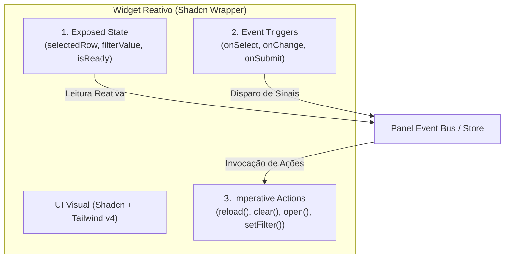

# Arquitetura de Painéis Reativos & Contratos de Widgets (Inspirada no ToolJet)

> **Status:** Especificação Ativa & Padrão Arquitetural  
> **Data:** Outubro de 2026  
> **Escopo:** `C:\dev\shadcn-local` (Design System Pessoal)  
> **Origem:** Extração e refino da arquitetura de componentes e dados do ToolJet, adaptada para o padrão Impeccable + Tailwind v4 + Shadcn UI.

---

## 1. O Problema nos Painéis de Visualização Tradicionais

Em dashboards, estúdios interativos e painéis operacionais, os componentes de UI não operam isolados:
- Uma seleção na **Tabela** altera as métricas nos **Cards de KPI**.
- Uma alteração no **Filtro de Data** recarrega os **Gráficos**.
- Um clique em um botão de linha abre uma **Gaveta (Sheet)** com os dados detalhados.

Quando construído de forma ingênua no React, isso gera:
1. **Prop Drilling excessivo** e estados locais espalhados.
2. **Re-renderizações desnecessárias** de todo o layout do painel a cada clique.
3. **Falta de interoperabilidade**: cada nova tela precisa reprogramar o "fio" de ligação entre a tabela e os cards.

---

## 2. A Solução: O Contrato Tridimensional de Widget

Extraído do modelo do ToolJet e refinado para o ecossistema Shadcn, cada componente de painel deixa de ser apenas uma casca visual passiva e passa a assinar um **Contrato Tridimensional**:



### Os 3 Vetores do Contrato:

1. **`exposedState` (O que o Widget expõe)**:
   - Valores que outros widgets podem ler de forma transparente.
   - *Exemplo (Tabela):* `{ selectedRow: RowData | null, selectedIds: string[], page: number }`.
   - *Exemplo (Filtro):* `{ range: [Date, Date], category: string }`.

2. **`events` (O que o Widget dispara)**:
   - Sinais de ciclo de vida e interação do usuário.
   - *Exemplo:* `onRowSelect(row)`, `onPageChange(page)`, `onRefresh()`.

3. **`actions` (O que o Widget aceita executar)**:
   - Métodos imperativos expostos via `ref` ou `panelBus`.
   - *Exemplo:* `table.refreshData()`, `modal.open()`, `form.reset()`.

---

## 3. Estrutura de Pastas no `shadcn-local`

A frente mora na estrutura modular do Design System:

```text
src/
├── lib/
│   └── reactive-panel/
│       ├── types.ts              # Tipos centrais (WidgetContract, PanelBus, StateMapping)
│       ├── panel-context.tsx     # Contexto e hook leve (usePanelBus / PanelProvider)
│       └── index.ts              # Ponto único de exportação
│
├── components/
│   └── patterns/
│       └── reactive-dashboard-panel.tsx  # Template de referência de painel orquestrado
```

---

## 4. Como Implementar em Novas Telas

### Passo 1: Envolver a tela no `PanelProvider`
```tsx
import { PanelProvider } from "@/lib/reactive-panel";

export function MeuPainel() {
  return (
    <PanelProvider id="live-monitoring">
      <PanelGrid>
        <MetricCardsWidget />
        <TableWidget />
        <InspectorWidget />
      </PanelGrid>
    </PanelProvider>
  );
}
```

### Passo 2: Definir o Contrato do Widget usando o hook `useWidgetContract`
```tsx
import { useWidgetContract } from "@/lib/reactive-panel";
import { Table, TableBody, ... } from "@/components/ui/table";

export function TableWidget() {
  const [selectedRow, setSelectedRow] = useState<Row | null>(null);

  // Assina o contrato com o barramento do painel
  const { emit } = useWidgetContract({
    widgetId: "clientes-table",
    exposedState: { selectedRow },
    actions: {
      clearSelection: () => setSelectedRow(null),
    },
  });

  const handleRowClick = (row: Row) => {
    setSelectedRow(row);
    emit("rowSelected", row);
  };

  return <Table>...</Table>;
}
```

### Passo 3: Consumir de outro Widget sem acoplamento direto
```tsx
export function InspectorWidget() {
  // Lê reativamente o estado exposto por outro widget
  const selectedCustomer = useWidgetState("clientes-table", "selectedRow");

  if (!selectedCustomer) {
    return <EmptyState message="Selecione um cliente na tabela" />;
  }

  return <Card>...</Card>;
}
```

---

## 5. Diretrizes Visuais & Anti-AI Slop

1. **Herança de Presets**: Todos os widgets reativos devem usar as classes semânticas do Shadcn (`bg-card`, `text-card-foreground`, `border-border`, etc.) para herdar instantaneamente os 5 presets de estilo do projeto (`Padrão`, `Editorial`, `Tech`, `Suave`, `Midnight`).
2. **Layout por CSS Grid Estrito**: Não aninhar cards infinitamente. Utilizar `grid-cols-12` com classes explícitas `col-span-12 lg:col-span-8` e espaçamento padronizado `gap-6`.
3. **Empty States e Loading States de Primeira Classe**: Todo widget deve definir visualmente seu estado de dados vazios (`empty-state.tsx`) e esqueleto de carregamento (`skeleton.tsx`).
